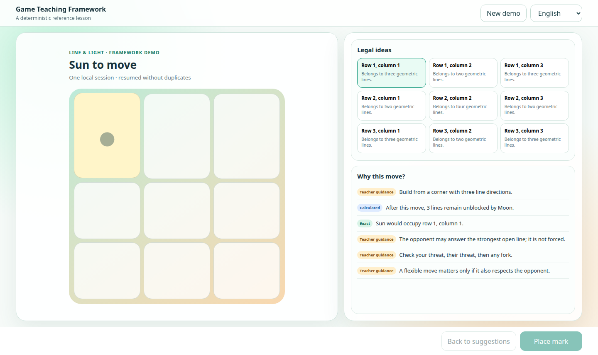

[English](../README.md) · [العربية](README.ar.md) · [Español](README.es.md) · [Français](README.fr.md) · [日本語](README.ja.md) · [한국어](README.ko.md) · [Tiếng Việt](README.vi.md) · [中文 (简体)](README.zh-Hans.md) · [中文（繁體）](README.zh-Hant.md) · [Deutsch](README.de.md) · [Русский](README.ru.md)

[](https://lazying.art)

# LazyGame · Framework für spielerisches Lernen

*Eine Local-first-Basis, die deterministische Spielregeln in klare, evidenzbewusste Lehre verwandelt.*

[](https://lazying.art) [](https://github.com/lachlanchen/LazyGame/actions/workflows/ci.yml) [](../LICENSE) [](https://github.com/sponsors/lachlanchen)

LazyGame liefert wiederverwendbare Verträge für Autorität, legale Kandidaten,
Datenschutz, Lokalisierung, Persistenz und Lehre. Jedes Produkt behält seine
eigene Regel-Engine und unabhängige Veröffentlichungshistorie.

| Donate | PayPal | Stripe |
| --- | --- | --- |
| [](https://chat.lazying.art/donate) | [](https://paypal.me/RongzhouChen) | [](https://buy.stripe.com/aFadR8gIaflgfQV6T4fw400) |

## Vorschau



## Gestaltungsprinzipien

- Deterministische Adapter besitzen Regeln, legale Aktionen, Wertung, verborgene Informationen, Zustandsübergänge und wiederholbare Historie.
- Kandidaten-IDs binden Zustand, Akteur und kanonische Aktion; veraltete oder erfundene Wahlen werden abgewiesen.
- Eine Vorschau verändert keine Sitzung und Bestätigung bleibt ausdrücklich.
- Engine- und Modellbelege werden von exakten Fakten, Berechnung, verfasster Anleitung und Analogie getrennt.
- Die Referenzoberfläche unterstützt 11 Sprachen einschließlich arabischem RTL-Layout.

## Arbeitsbereich

| Pfad | Zweck |
| --- | --- |
| `packages/core/` | Verträge, Kandidaten, Sichtbarkeit, i18n, Sitzungen und Replay |
| `packages/react/` | Barrierearme Lehrkomponenten und React-Controller |
| `apps/demo/` | Kleines, vollständiges Referenzspiel |
| `LazyWeiqi/` | [LazyWeiqi](https://github.com/lachlanchen/LazyWeiqi)-Submodul |
| `LazyChess/` | [LazyChess](https://github.com/lachlanchen/LazyChess): Schach, Xiangqi und Shogi |
| `LazyPoker/` | [LazyPoker](https://github.com/lachlanchen/LazyPoker): Hold'em, Bridge und Guandan |
| `LazyMahjong/` | [LazyMahjong](https://github.com/lachlanchen/LazyMahjong)-Submodul |

## Schnellstart

```bash
git clone --recurse-submodules https://github.com/lachlanchen/LazyGame.git
cd LazyGame
npm ci
npm run check
npm run app:start
```

Öffne <http://127.0.0.1:8011/> für gebundene Kandidaten, unverändernde Vorschau,
ausdrückliche Bestätigung, lokalisierte Belege und doppelfreie lokale Fortsetzung.

## Architekturgrundlage

Der vollständige Vertrag steht in [`docs/framework-contract.md`](../docs/framework-contract.md).
Die Browser-Demo hat absichtlich nur einen Schreiber, weil Web Storage keine
Mehrschlüssel-Transaktion bietet; Mehrschreiber-Systeme müssen serialisieren oder eine transaktionale Datenbank verwenden.

## Validierung

```bash
npm run lint
npm test
npm run build
npm audit --audit-level=high
git diff --check
```

Engines, Modelle, Datenbanken, Browserprofile, private Sitzungen und Laufzeitbelege bleiben außerhalb von Git.

## Zitieren

Wenn du LazyGame in Forschung verwendest, zitiere das Repository. GitHub liest
[`CITATION.cff`](../CITATION.cff) und zeigt **Cite this repository** an.

```bibtex
@software{chen_lazygame_2026,
  author = {Chen, Lachlan},
  title = {LazyGame: Game Teaching Framework},
  year = {2026},
  url = {https://github.com/lachlanchen/LazyGame}
}
```

## Status und Umfang

LazyGame ist Lehrgrundlage und Referenzimplementierung, keine universelle
Regel-Engine und kein authentifizierter Fernserver. Die vier Produkte bleiben unabhängig versioniert und hier als Submodule verknüpft.
